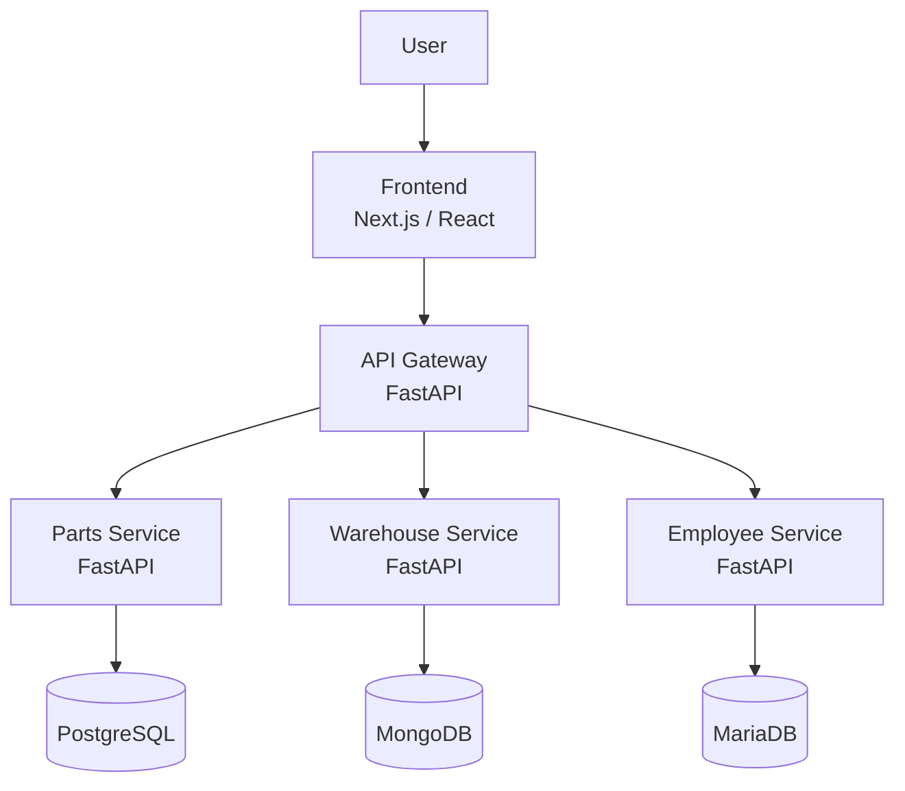
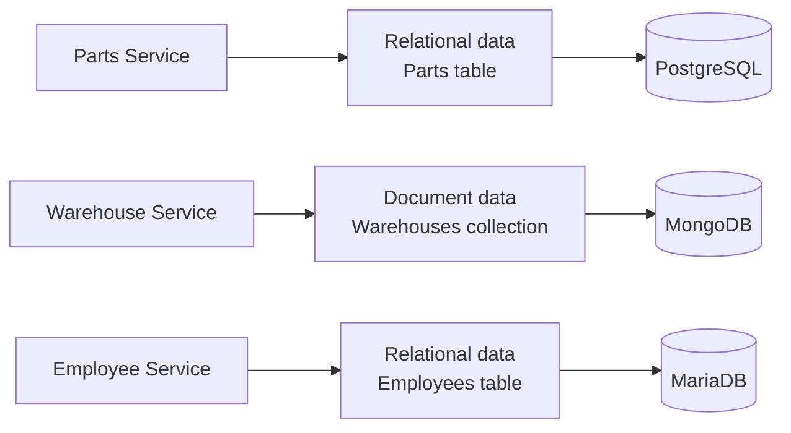
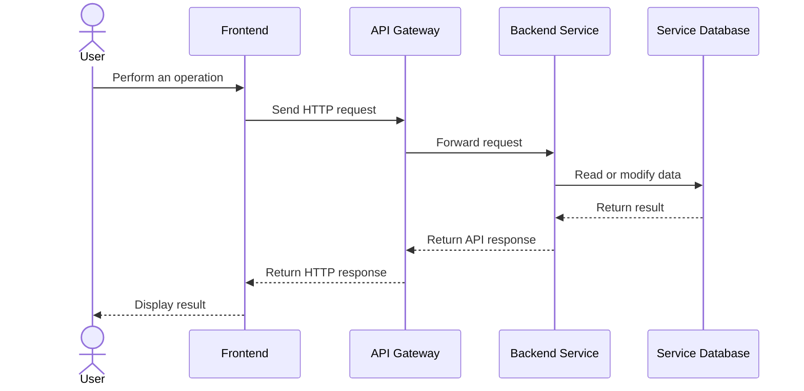
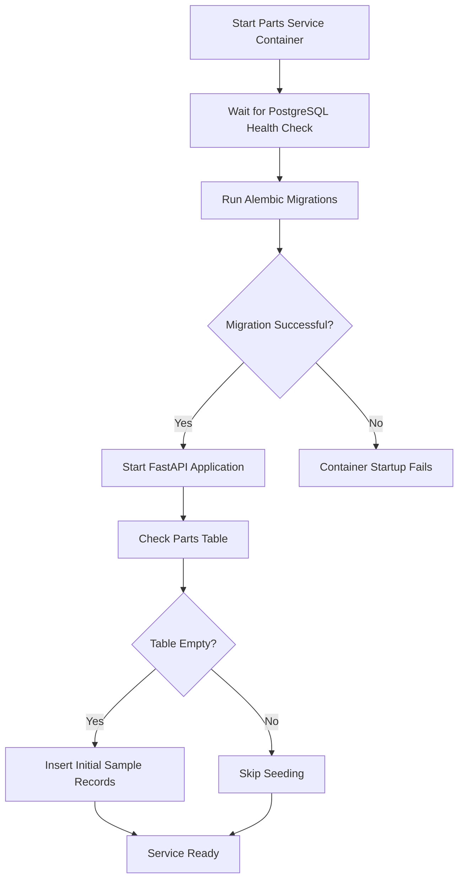

# SpareParts Manager

SpareParts Manager is an inventory management application built with a distributed microservices architecture. It provides separate services for managing spare parts, warehouses, and employees, with a centralized API gateway and a web frontend.

The project uses 3 different database technologies to demonstrate how independent services can manage their own data using storage systems.

## Table of Contents

- [Overview](#overview)
- [Architecture](#architecture)
- [Technology Stack](#technology-stack)
- [Services](#services)
- [Database Design](#database-design)
- [Request Flow](#request-flow)
- [Database Initialization](#database-initialization)
- [Prerequisites](#prerequisites)
- [Configuration](#configuration)
- [Getting Started](#getting-started)
- [API Documentation](#api-documentation)
- [Development](#development)
- [Data Persistence](#data-persistence)

## Overview

The main objectives of SpareParts Manager are to:

- Manage spare parts inventory.
- Manage warehouse information.
- Manage employee information.
- Separate business responsibilities into independent microservices.
- Use different database technologies for different services.
- Centralize frontend API communication through an API gateway.
- Automate database initialization and initial data seeding.
- Run the application and its dependencies using Docker Compose.

## Architecture

The application follows a distributed microservices architecture. Each business service is responsible for its own domain and database.



### Architectural Principles

- **Separation of concerns:** each microservice handles a specific business domain.
- **Database ownership:** each service accesses its own database rather than relying on other services to read or modify its data.
- **Centralized entry point:** the API gateway routes frontend requests to the appropriate service.
- **Containerization:** Docker Compose manages the services and database containers.
- **Independent responsibilities:** services can evolve separately while communicating through their APIs.

## Technology Stack

| Component | Technology |
|---|---|
| Frontend | Next.js, React, TypeScript |
| Styling | Tailwind CSS |
| Backend | Python, FastAPI |
| Parts database | PostgreSQL |
| Warehouse database | MongoDB |
| Employee database | MariaDB |
| Parts ORM | SQLAlchemy |
| Parts migrations | Alembic |
| Warehouse database driver | PyMongo |
| Containerization | Docker, Docker Compose |
| API communication | HTTP/REST |
| API documentation | OpenAPI / Swagger UI |

## Services

### Frontend

The frontend provides the user interface for managing the inventory system.

Responsibilities:

- Display the application interface.
- Provide navigation between Parts, Warehouses, and Employees.
- Send API requests through the API gateway.
- Display retrieved data and reflect user modifications.

The frontend is implemented using Next.js and React.

### API Gateway

The API gateway acts as the central entry point for frontend requests.

Responsibilities:

- Receive requests from the frontend.
- Route requests to the appropriate backend service.
- Provide a unified API entry point.
- Reduce the need for the frontend to communicate directly with individual services.

The gateway uses environment variables to configure backend service URLs.

### Parts Service

The Parts Service manages spare parts inventory using PostgreSQL.

Responsibilities:

- Create, retrieve, update, and delete spare parts.
- Retrieve parts by name.
- Support pagination.
- Validate inventory data.
- Maintain the relational database schema using Alembic migrations.
- Insert initial sample records when the parts table is empty.

The service uses SQLAlchemy to interact with PostgreSQL.

### Warehouse Service

The Warehouse Service manages warehouse information using MongoDB.

Responsibilities:

- Create, retrieve, update, and delete warehouses.
- Search warehouses by name.
- Support pagination.
- Validate warehouse data.
- Insert initial sample records when the warehouse collection is empty.

The service uses PyMongo to interact with MongoDB.

### Employee Service

The Employee Service manages employee information using MariaDB.

Responsibilities:

- Store and retrieve employee records.
- Support employee management operations exposed by its API.
- Initialize the required database structures.
- Insert initial sample records when the employee table is empty.

The service uses SQLAlchemy to interact with MariaDB.

## Database Design

Each service uses a separate database technology.



### PostgreSQL

PostgreSQL stores structured spare parts data.

The Parts Service uses SQLAlchemy models and Alembic migrations to manage the schema. The parts table includes fields such as:

- `id`
- `name`
- `description`
- `stock_quantity`
- `created_at`
- `updated_at`

The `stock_quantity` field must not be negative, and an index is defined for the part name to support name-based queries.

### MongoDB

MongoDB stores warehouse records as documents in the `warehouses` collection.

Warehouse documents contain:

- `_id`
- `name`
- `location`
- `description`
- `created_at`
- `updated_at`

MongoDB generates the document identifier automatically.

### MariaDB

MariaDB stores structured employee data. The employee schema is managed by the Employee Service.

The exact employee fields are defined in the service's implementation.

## Request Flow

Frontend requests are sent through the API gateway to the relevant service.



Each service handles its own business logic and database operations. The gateway forwards requests but does not replace the responsibilities of the individual services.

## Database Initialization

Docker Compose starts the database containers before their dependent services. Database health checks help ensure that the databases are ready to accept connections.

The Parts Service runs its Alembic migrations before starting the FastAPI application. During application startup, the seed function inserts initial records if the parts table is empty.



### Seed Behavior

The initial seed data is intended for educational and development use.

- Initial records are inserted only when the relevant table or collection is empty.
- Existing records are preserved during ordinary restarts.
- The seed process does not automatically refill a partially populated table or collection.
- Deleting a database volume removes persisted data and may require database migrations and seeding to run again.

## Prerequisites

Install the following tools before running the project:

- Docker Desktop with Docker Compose.
- Git.
- A terminal such as Git Bash, PowerShell, or a Linux shell.
- A web browser.

Node.js and Python may also be useful for local development outside Docker.

## Configuration

The application uses environment variables to configure ports and database connections.

Create or update the root `.env` file using the project's existing `.env.example` as a reference.

Typical configuration variables include:

| Variable | Purpose |
|---|---|
| `POSTGRES_DB` | PostgreSQL database name |
| `POSTGRES_USER` | PostgreSQL username |
| `POSTGRES_PASSWORD` | PostgreSQL password |
| `POSTGRES_PORT` | Host port for PostgreSQL |
| `MONGO_INITDB_DATABASE` | MongoDB database name |
| `MONGO_PORT` | Host port for MongoDB |
| `MARIADB_DATABASE` | MariaDB database name |
| `MARIADB_USER` | MariaDB username |
| `MARIADB_PASSWORD` | MariaDB password |
| `MARIADB_ROOT_PASSWORD` | MariaDB root password |
| `MARIADB_PORT` | Host port for MariaDB |
| `PARTS_SERVICE_PORT` | Parts Service host and application port |
| `WAREHOUSE_SERVICE_PORT` | Warehouse Service host and application port |
| `EMPLOYEE_SERVICE_PORT` | Employee Service host and application port |
| `GATEWAY_PORT` | API gateway port |
| `FRONTEND_PORT` | Frontend host port |
| `NEXT_PUBLIC_API_URL` | Frontend API gateway URL |

Use the variable names defined in the current `.env.example` and `compose.yaml` as the source of truth.

**Security:** do not commit `.env` or real credentials to version control. Use development credentials only for local educational environments.

## Getting Started

### 1. Clone the repository

```bash
git clone <repository-url>
cd spareparts-manager
```

Replace `<repository-url>` with the actual Git repository URL.

### 2. Configure environment variables

Create the root `.env` file using the existing example configuration. Keep the actual credentials local.

### 3. Validate Docker Compose configuration

```bash
docker compose config --quiet
```

If the command finishes without errors, the Compose configuration is syntactically valid.

### 4. Build and start the application

```bash
docker compose up -d --build
```

This command builds the application containers and starts the services in the background.

### 5. Check service status

```bash
docker compose ps
```

Inspect logs if a service does not start:

```bash
docker compose logs --tail=100 parts-service
docker compose logs --tail=100 warehouse-service
docker compose logs --tail=100 employee-service
docker compose logs --tail=100 gateway
docker compose logs --tail=100 frontend
```

### 6. Stop the application

```bash
docker compose down
```

This stops and removes the containers while preserving named database volumes.

Do not use `docker compose down -v` unless you intentionally want to delete the associated named volumes and their persisted data.

## API Documentation

When the services are running, FastAPI provides interactive Swagger UI documentation.

The following URLs assume the default ports shown in the project's configuration:

| Component | URL |
|---|---|
| Frontend | `http://localhost:3000` |
| API Gateway | `http://localhost:8000` |
| Parts Service | `http://localhost:8001/docs` |
| Warehouse Service | `http://localhost:8002/docs` |
| Employee Service | `http://localhost:8003/docs` |

If your `.env` defines different ports, use those values instead.

The gateway exposes the frontend-facing API entry point. Direct service URLs are useful for local development and debugging.

## Development

### Inspect running containers

```bash
docker compose ps
```

### Follow service logs

```bash
docker compose logs -f parts-service
```

### Rebuild a specific service

```bash
docker compose up -d --build parts-service
```

Replace `parts-service` with another service name when necessary.


### Review Git changes

```bash
git status
git diff
```

Prefer focused commits for changes to individual services.

Example commit messages:

```text
parts: seed initial spare parts on startup
warehouse: seed initial warehouse data on startup
employee: seed initial employee data on startup
```

## Data Persistence

Database data is stored in named Docker volumes.

| Volume | Purpose |
|---|---|
| `postgres_data` | PostgreSQL data |
| `mongodb_data` | MongoDB data |
| `mariadb_data` | MariaDB data |

The Compose project name determines the final Docker volume names. For example, a volume may appear with a prefix such as `spareparts-manager_`.

Stopping containers does not normally delete database data. Removing a named volume permanently deletes its persisted contents.
